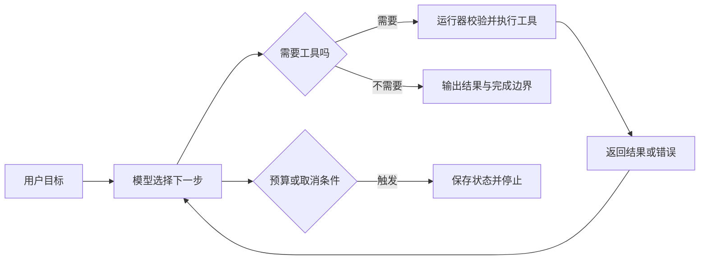

# 01 · Agent 的核心：行动之后，再看结果

> 原稿：2026-04-12 的教程 Ch02；公开修订：2026-11-09。
> 本文讨论一个常见的工具型 Agent 结构，不把它当作所有 Agent 的唯一定义。

## 从一个具体任务出发

假设要统计一个目录里有多少篇 Markdown 文档。只生成文字的模型可以解释统计方法；接入目录读取工具后，系统可以真正取得文件列表、统计数量，再把结果交给用户。

关键变化是：**后一次决策能够使用前一次行动产生的新信息。**



“模型想做什么”和“系统允许做什么”是两个问题。工具执行器需要检查参数、路径范围和权限。模型生成了一个动作，不等于动作已经执行，更不等于执行成功。

## 一个运行器至少需要处理四种结果

| 观察到的情况 | 应怎样处理 | 不能直接推断什么 |
|---|---|---|
| 文件列表返回成功 | 继续统计或检查过滤条件 | 目录内每篇文档都已阅读 |
| 文件不存在 | 检查路径和现有目录 | 整个任务无法完成 |
| 请求超时，执行结果未知 | 查询实际状态，再决定是否重试 | 刚才一定没有写入 |
| 模型不再调用工具 | 核对验收条件并结束或说明未完成 | 用户目标一定达成 |

错误可以作为下一轮的输入，但不要把所有异常原样塞回模型：访问凭据、请求头、个人数据和冗长堆栈需要处理，重试还要区分是否会重复产生副作用。

## 停止也是系统的一部分

常见停止条件包括：已满足验收、达到调用或费用预算、用户取消、权限不足、重复失败且没有新信息。给循环加一个最大次数，只能避免无穷运行，不能替代完成判断。

下面是结构示意，不是某个 SDK 的可运行接口：

```text
读取目标与已确认约束
在预算内循环：
    根据当前观察选择下一步
    如果输出最终答复：检查验收条件，报告证据与缺口
    如果提出工具调用：校验权限和参数，执行，记录结果
    如果结果未知：先查状态，避免重复写入
退出时：保存已完成部分、失败原因和继续所需状态
```

## 与 ReAct 的关系

[ReAct 论文](https://arxiv.org/abs/2210.03629) 研究了推理与环境行动交错的方式。本文借它解释反馈循环；现代工具调用实现不一定显示推理文本，也不一定沿用论文的提示格式。工具轨迹应记录可观察动作与返回结果，不要求记录模型的私有思考。

## 动手练习

用纸画出“列目录→只保留 `.md`→统计→返回结果”的轨迹，再分别插入文件不存在、权限不足和用户取消三种事件。每种事件写清楚下一步、是否重试、最后怎样告诉用户。

能解释“执行成功”和“目标完成”的区别，比背出某个框架的函数名更重要。

下一篇：[怎样组合工作流](02-workflow-patterns.md)。
